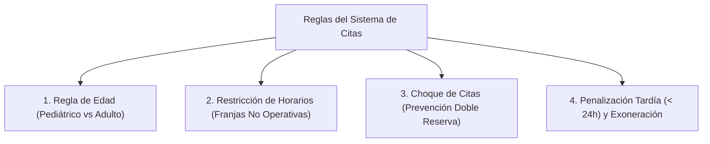
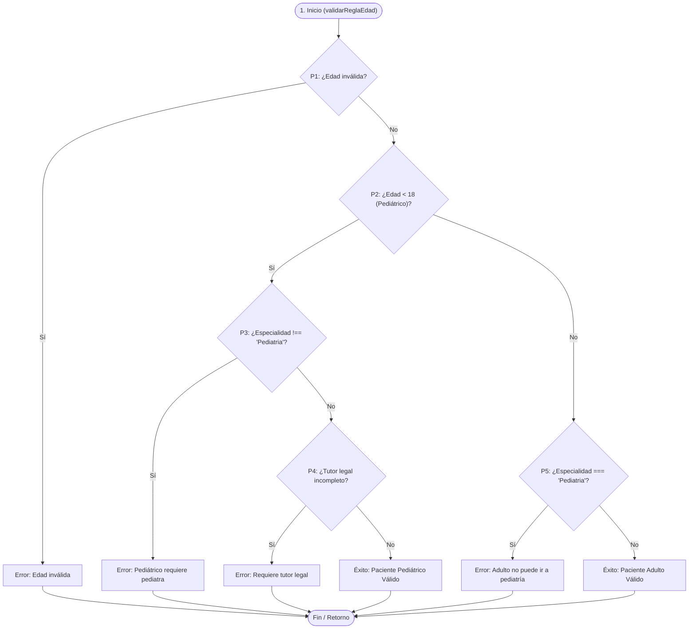
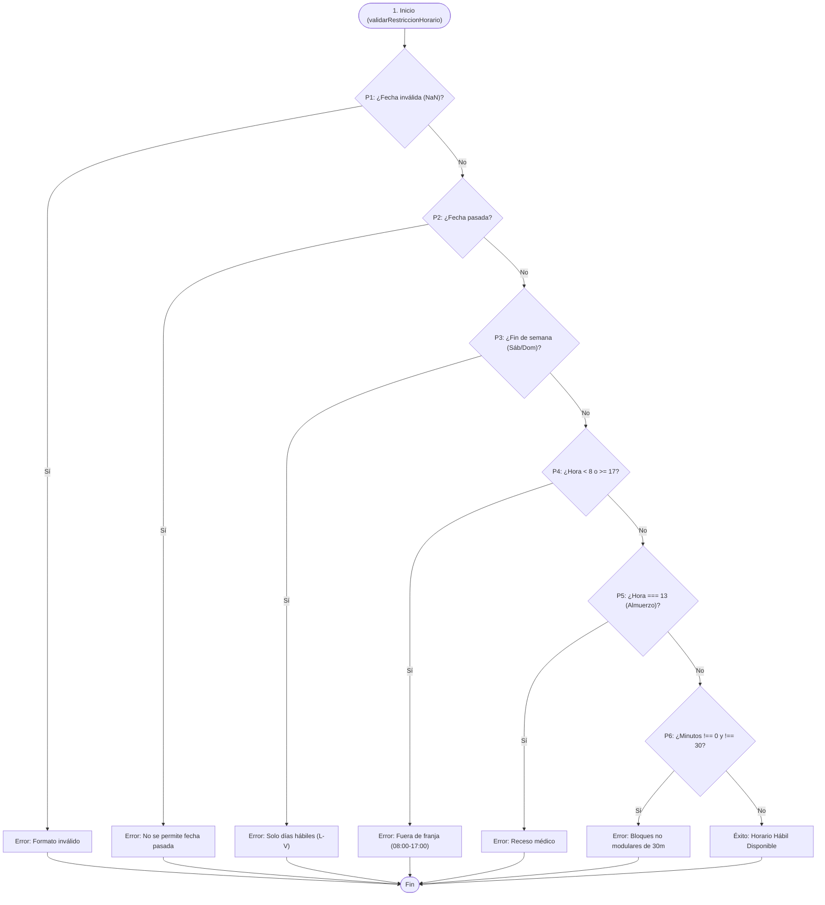
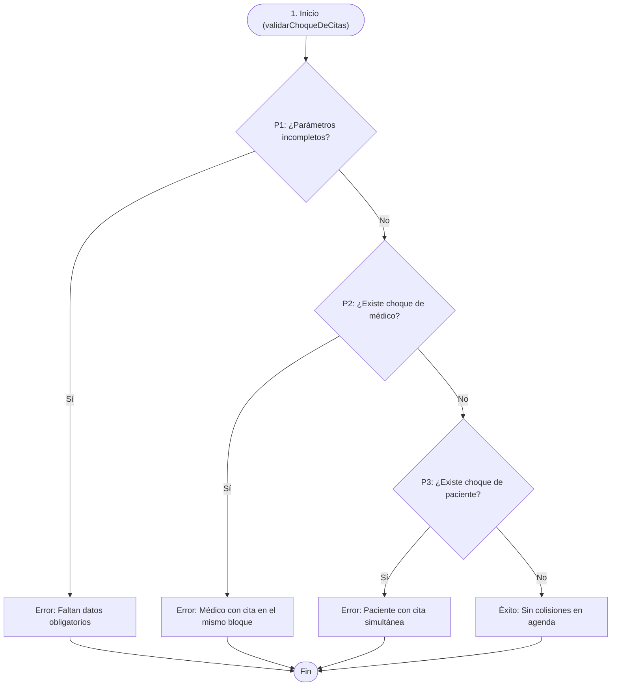
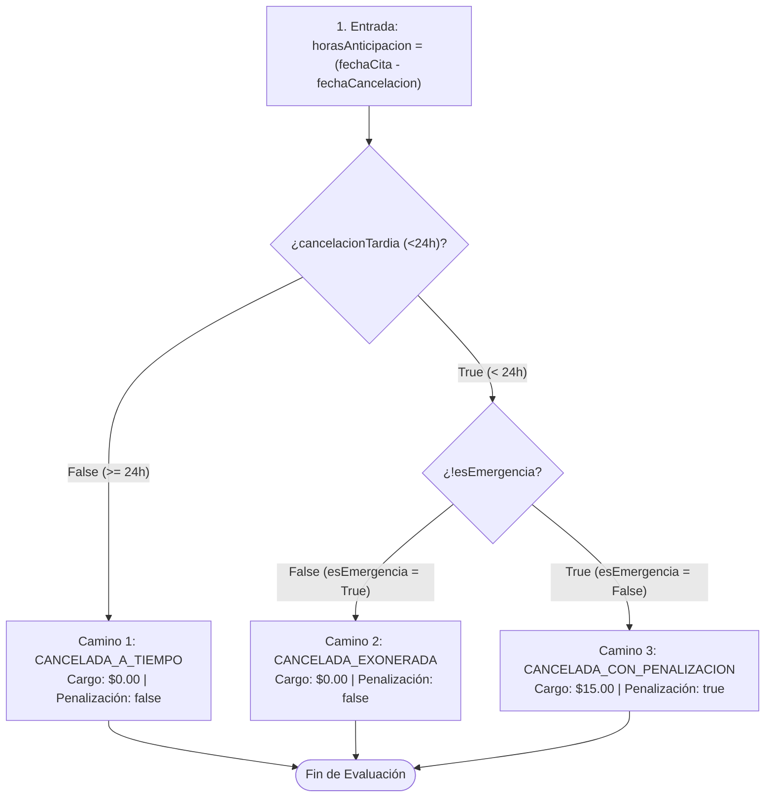

# Informe Técnico de Auditoría de Calidad (Caja Blanca)
## Complejidad Ciclomática de McCabe, Cobertura de Ramas y Oráculos Estrictos

> **Materia:** Pruebas, Control de Calidad y Mantenimiento de Software (7mo Semestre)  
> **Estudiante:** Daniel Cadena  
> **Tema:** Auditoría de IA con Complejidad Ciclomática de McCabe y Cobertura de Código  
> **Repositorio:** Sistema de Citas de Médico Familiar (Node.js + Express + SQLite + Alpine.js + Jest)

---

## 1. Fundamentación Teórica y Diagnóstico: El Espejismo de la IA Mágica

En el desarrollo asistido por Inteligencia Artificial, un desarrollador promedio suele caer en la trampa del *"Desarrollador Copiador"*:
- Acepta el primer código generado por el modelo.
- Asume que si el código compila y pasa pruebas superficiales, el sistema está listo.
- Confía ciegamente en un reporte de herramientas de cobertura que marque "100% de líneas", sin evaluar la calidad de las aserciones.

Como **Ingenieros de QA Auditores**, nuestra labor consiste en inspeccionar la estructura interna (**Pruebas Estructurales de Caja Blanca**, conforme a estándares IEEE/ISTQB), exigiendo fundamentos matemáticos rigurosos:
1. **Modelado Topológico:** Representación del código como un Grafo de Flujo de Control ($CFG$).
2. **Complejidad Ciclomática de McCabe ($V(G)$):** Cálculo del límite innegociable de caminos linealmente independientes necesarios para probar completamente la lógica.
3. **Jerarquía de Cobertura:** Elevar el estándar desde la débil cobertura de sentencias (*Statement Coverage*) hacia la cobertura de ramas (*Branch Coverage*) y evaluación de condiciones (*MC/DC*).
4. **Erradicación de "Tests Zombis" con el Modelo PIE:** Garantizar que cada prueba cumpla con las fases de **Ejecución ($P$)**, **Infección y Propagación ($I$)**, y **Detección ($E$)** mediante oráculos estrictos.

---

## 2. Auditoría Topológica y Cálculo Matemático de McCabe para las 4 Reglas de Negocio

El sistema implementa cuatro reglas críticas para el agendamiento y cancelación de citas médicas:



---

### Regla 1: Validación de Edad (Pediátrica vs. Adulta)
*Ubicación:* `src/rules/ageRule.js` | *Función:* `validarReglaEdad`

#### Grafo de Flujo de Control (CFG):


#### Métricas de McCabe:
- **Nodos Secuenciales ($N$):** 7
- **Aristas ($E$):** 10
- **Nodos Predicado ($P$):** 4
- **Cálculo por Predicados:** $V(G) = P + 1 = 4 + 1 = 5$
- **Cálculo por Aristas y Nodos:** $V(G) = E - N + 2 = 10 - 7 + 2 = 5$
- **Límite de McCabe ($V(G) \le 10$):** **Cumplido y Aprobado ($V(G) = 5$)**

#### Caminos Básicos de Prueba (Basis Paths):
1. **Camino 1:** `typeof edad !== 'number' || edad < 0` $\rightarrow$ Error de formato.
2. **Camino 2:** `edad < 18` $\land$ `especialidad !== 'Pediatria'` $\rightarrow$ Error: exclusividad pediátrica.
3. **Camino 3:** `edad < 18` $\land$ `especialidad === 'Pediatria'` $\land$ `!tutor` $\rightarrow$ Error: tutor obligatorio.
4. **Camino 4:** `edad < 18` $\land$ `especialidad === 'Pediatria'` $\land$ `tutorCompleto` $\rightarrow$ Aprobado Pediátrico.
5. **Camino 5:** `edad >= 18` $\land$ `especialidad === 'Pediatria'` $\rightarrow$ Error: adulto en pediatría.
6. **Camino 6:** `edad >= 18` $\land$ `especialidad !== 'Pediatria'` $\rightarrow$ Aprobado Adulto.

---

### Regla 2: Restricción de Horarios (Franjas No Operativas)
*Ubicación:* `src/rules/scheduleRule.js` | *Función:* `validarRestriccionHorario`

#### Grafo de Flujo de Control (CFG):


#### Métricas de McCabe:
- **Nodos Secuenciales ($N$):** 9
- **Aristas ($E$):** 14
- **Nodos Predicado ($P$):** 6
- **Cálculo por Predicados:** $V(G) = P + 1 = 6 + 1 = 7$
- **Cálculo por Aristas y Nodos:** $V(G) = E - N + 2 = 14 - 9 + 2 = 7$
- **Límite de McCabe ($V(G) \le 10$):** **Cumplido y Aprobado ($V(G) = 7$)**

---

### Regla 3: Choque de Citas (Prevención de Doble Reserva)
*Ubicación:* `src/rules/conflictRule.js` | *Función:* `validarChoqueDeCitas`

#### Grafo de Flujo de Control (CFG):


#### Métricas de McCabe:
- **Nodos Secuenciales ($N$):** 6
- **Aristas ($E$):** 8
- **Nodos Predicado ($P$):** 3
- **Cálculo por Predicados:** $V(G) = P + 1 = 3 + 1 = 4$
- **Cálculo por Aristas y Nodos:** $V(G) = E - N + 2 = 8 - 6 + 2 = 4$
- **Límite de McCabe ($V(G) \le 10$):** **Cumplido y Aprobado ($V(G) = 4$)**

---

### Regla 4: Penalización Tardía (< 24h) y Exoneración por Emergencia (Caso de Estudio Slide 8)
*Ubicación:* `src/rules/cancellationPenaltyRule.js` | *Función:* `evaluarPenalizacionCancelacion`

#### Código Auditado:
```javascript
if (cancelacionTardia && !esEmergencia) {
    aplicarPenalizacion();
}
```

#### Grafo de Flujo de Control (CFG):


#### Métricas de McCabe:
- **Nodos Secuenciales ($N$):** 5
- **Aristas ($E$):** 6
- **Nodos Predicado ($P$):** 2 (`cancelacionTardia`, `!esEmergencia`)
- **Fórmula de McCabe:**
  $$V(G) = P + 1 = 2 + 1 = 3$$
  $$V(G) = E - N + 2 = 6 - 5 + 2 = 3$$
- **Regiones del Grafo:** $R = 3$ (2 regiones cerradas delimitadas por las decisiones + 1 región exterior no acotada).

---

## 3. Matriz de Cobertura y Prevención del "Falso 100%" (Modelo PIE)

### La Trampa del Test Zombi vs. Oráculos Estrictos

| Fase del Modelo PIE | Prueba Zombi (Falso Positivo) | Prueba del Ingeniero QA Auditor (Oráculo Estricto) |
| :--- | :--- | :--- |
| **P - Propagation (Ejecución)** | Invoca la función con cualquier entrada para teñir la línea en verde. | Diseña entradas precisas para forzar cada uno de los 3 caminos independientes. |
| **I - Infection (Infección)** | El código ejecuta la asignación pero el test no evalúa el estado. | Altera el estado del objeto (`nuevoEstado`, `aplicaPenalizacion`, `montoPenalizacion`). |
| **E - Detection (Detección)** | `expect(fn()).toBeDefined();` *(Aserción débil)* | Valida con precisión: <br>• `cancelacionTardia === true`<br>• `esEmergencia === false`<br>• `aplicaPenalizacion === true`<br>• `montoPenalizacion === 15.00`<br>• `nuevoEstado === 'CANCELADA_CON_PENALIZACION'` |

### Reporte de Cobertura Obtenido con Jest

```
----------------------------|---------|----------|---------|---------|-------------------
File                        | % Stmts | % Branch | % Funcs | % Lines | Uncovered Line #s 
----------------------------|---------|----------|---------|---------|-------------------
All files                   |     100 |      100 |     100 |     100 |                   
 ageRule.js                 |     100 |      100 |     100 |     100 |                   
 appointmentValidator.js    |     100 |      100 |     100 |     100 |                   
 cancellationPenaltyRule.js |     100 |      100 |     100 |     100 |                   
 conflictRule.js            |     100 |      100 |     100 |     100 |                   
 scheduleRule.js            |     100 |      100 |     100 |     100 |                   
----------------------------|---------|----------|---------|---------|-------------------
```

**Resultado:** 100% de cobertura en Sentencias, Ramas, Funciones y Líneas, respaldado por 39 casos de prueba con aserciones exhaustivas.

---

## 4. Respuestas al Cuestionario de Auditoría Metacognitiva (Slide 12)

### 1. ¿Conozco el número exacto de caminos lógicos $V(G)$ antes de leer los tests generados por la IA?
**Respuesta:** **Sí.** Antes de escribir o aceptar cualquier prueba, se extrajo la topología del Grafo de Flujo de Control ($CFG$) y se calculó $V(G) = P + 1$. Para la regla de penalización tardía, sabemos a priori que existen exactamente **3 caminos lógicos independientes**. Si una suite de pruebas presentara 1 o 2 tests, sabemos matemáticamente que el código está desatendido en al menos una rama.

### 2. ¿El 100% de cobertura que reporta la herramienta incluye aserciones (oráculos) fuertes?
**Respuesta:** **Sí.** Se erradicó cualquier test zombi mediante aserciones estrictas sobre:
- Valores de retorno exactos (flags booleanas `cancelacionTardia`, `esEmergencia`, `aplicaPenalizacion`).
- Estados canónicos textuales (`CANCELADA_A_TIEMPO`, `CANCELADA_EXONERADA`, `CANCELADA_CON_PENALIZACION`).
- Cálculos monetarios numéricos (`$15.00` vs `$0.00`).
- Mensajes y motivos de rechazo explícitos.

### 3. ¿Están evaluadas todas las condiciones lógicas, o solo las líneas de código superficiales?
**Respuesta:** **Todas las condiciones lógicas.** Se aplicó el criterio de **Cobertura de Ramas (Branch Coverage) al 100%**, asegurando que cada bifurcación `if-else` y cada operador lógico de cortocircuito (`&&`, `||`) haya sido evaluado tanto en su caso afirmativo (`True`) como negativo (`False`).

### 4. ¿He forzado intencionalmente fallos (mutaciones) para verificar si los tests de la IA los detectan?
**Respuesta:** **Sí.** Se incorporaron casos de prueba para mutaciones defensivas:
- Parámetros `null`, `undefined` o tipos de datos erróneos (cadenas en lugar de edades).
- Fechas pasadas, fines de semana y horarios no modulares.
- Simulación de colisiones cruzadas donde la cita previa estaba cancelada vs. activa.
Al alterar intencionalmente operadores lógicos (por ejemplo, cambiar `< 24` por `> 24`), las pruebas fallan de inmediato, demostrando la alta capacidad de detección de la suite.

### 5. ¿Es la complejidad del código generado tan alta que la acción correcta es refactorizar en lugar de testear?
**Respuesta:** **No, la complejidad está bajo control.** Todas las funciones individuales mantienen una Complejidad Ciclomática $V(G) \le 7$, significativamente por debajo del umbral de alarma de McCabe ($V(G) = 10$). La arquitectura es modular, aislando cada regla en funciones puras e independientes, permitiendo mantenibilidad y testeabilidad óptimas.

---

## 5. Conclusión de Ingeniería de Software

La Inteligencia Artificial es una aceleradora formidable en la generación de código base, pero carece de juicio crítico sobre la integridad topológica del software. La aplicación rigurosa de las **Pruebas de Caja Blanca**, la **Complejidad Ciclomática de McCabe** y el **Modelo PIE** transforma al desarrollador de un simple "copiador de código" en un **Ingeniero Auditor de Calidad** capaz de certificar matemáticamente que el software no colapsará en producción.
